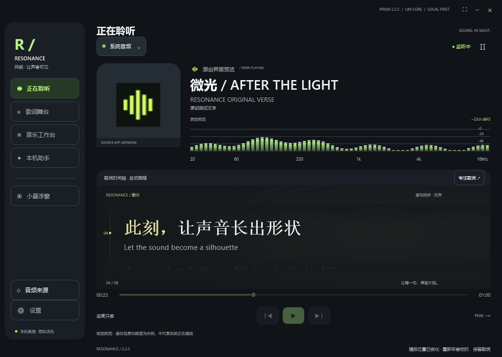
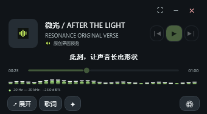

# RESONANCE · 共振

**2.2.5 · PRISM / 棱镜 · 内测版 · r5 小更新**

听你正在听的。让频谱、歌词、录制与本机 AI 留在同一个窗口，继续使用你喜欢的播放器或浏览器。

**[共振官网](https://pz099.github.io/RESONANCE/)** · **[直接下载 Windows 安装器 · 292.6 MB](https://github.com/PZ099/RESONANCE/releases/download/v2.2.5/RESONANCE-2.2.5-Setup-r6.exe)**

安装器直接下载 EXE，内含启动和音频来源修复。首次仍需下载约 28.24 GB 完整数据，全部功能与本机模型保留。中国大陆网络速度与可用性尚未验证。

[安装说明](installation-guide.txt) · [模型清单](models.md) · [更新日志](CHANGELOG.md) · [原始 ZIP 校验](SHA256.txt)

## 一个窗口，容纳聆听

*软件真实界面预览，图中的歌名与歌词为原创演示文字。*

- 来源列表自动刷新，改善浏览器子进程和多输出设备发现。
- 来源没有提供歌名时，继续音频识曲与本机听写；找到可靠歌词后优先显示。
- 将频谱、歌词、封面、本机助手与设置整合到一起，小窗保持置顶。
- 支持录制与片段整理；排序、补录和媒体控制取决于来源是否提供可靠时间与控制接口。
- 所有神经网络推理在本机；在线歌词、公开资料和可选指纹服务需要网络。

## 新装或仅更新

首次安装：运行 RESONANCE-2.2.5-Setup-r6.exe，下载并校验完整基础数据，选择最新版本或全版本；原安装向导完成后，Setup 自动应用内嵌修复。

已经装好完整 2.2.5：完全退出共振后，运行同一个 EXE，选择 **“仅更新已安装程序”**。无需重新下载模型或约 28 GB 基础数据，原有密钥、内测资格、录音、设置和历史版本保留。

| 选项 | 基础包占用 | 内容 |
| --- | --- | --- |
| 最新版本 · 推荐 | 约 31.11 GB | 全部当前功能与模型，**不影响正常使用**。 |
| 全版本 | 约 32.78 GB | 保留基础包中的 14 个历史版本与更新前条目。 |

这些数字是基础占用。r5 修复约新增 **0.23 GB** 程序对象，恢复备份及临时空间另计；首次安装另需约 **28.24 GB** 下载缓存。

## 安装器校验

文件：RESONANCE-2.2.5-Setup-r6.exe  
准确大小：**292,568,098 字节**（292.6 MB）  
SHA-256：

~~~text
E47DCE0241F008E130F182BED5755AE97DB8C363A2B2F6CFE804CC97689DEC70
~~~

此摘要仅适用于当前 r5 安装器。旧 Setup.exe、原 Offline.exe / 15 个 BIN 及完整 ZIP 均保持原样。

## 已有离线基础包

原 Offline.exe 与全部 15 个 BIN 可继续用于基础安装。保留全部文件名并按同次发布的 SHA256SUMS.txt 核验。基础安装后仍需运行最新 RESONANCE-2.2.5-Setup-r6.exe，选择“仅更新已安装程序”，才能获得 r5 修复。

GitHub 自动生成的 Source code ZIP 是本发布仓库文件，**不是软件安装包**。

## 使用范围

推荐 Windows 11 x64。按应用捕获需要 build 20348 或更新；部分受保护或绕过系统混音的音频仍可能无法捕获。播放、切歌和进度功能取决于来源支持情况。

没有标题的音源也会尝试音频识别，但不能保证所有歌曲、演唱会和录音版本都可匹配。参考曲库、歌词来源覆盖、噪声和伴奏都会影响结果；复杂演唱的字幕仍可能出错。

中国大陆网络、完整 28.24 GB 公网重新下载和全新 Windows 完整安装尚未完成验证。当前内测版尚无商业代码签名，请核对来源与文件摘要。

请在软件中备份内测代码；主题、星轨背景、歌词字体、密钥注册图文教程与使用手册均保留。

官网已升级 Motion 视觉：三种色调的原创歌词演示、滚动与预览过渡、阅读进度、动效暂停，以及更完整的安装问答。演示只展示视觉效果，不会读取音频。软件和安装器版本仍为 2.2.5 r5。

## r6：选盘与自动完整包

[完整包自动下载器 · 292.6 MB](https://github.com/PZ099/RESONANCE/releases/download/v2.2.5/RESONANCE-2.2.5-OfflineDownload.exe) 默认只下载、不安装。打开后选磁盘并开始，自动获取约28.24GB基础数据，校验后将17个安装文件、说明和校验清单放到一起，不用逐项点下载。下载缓存可选盘，软件与共享模型仍使用当前Windows用户目录。
