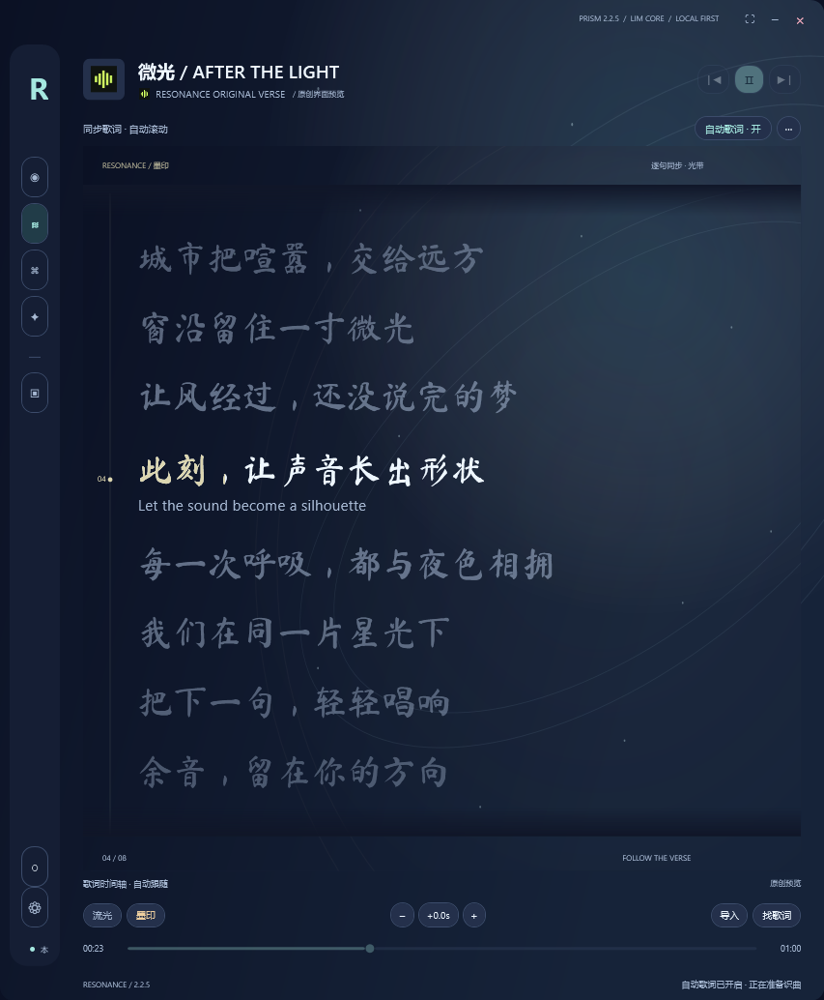

# RESONANCE · 共振

### 让声音被看见。

**2.2.5 · PRISM / 棱镜 · 内测版**

听你正在听的。把频谱、歌词和音乐故事，留在同一个窗口。

RESONANCE 是 Windows 上的音乐伴侣：监听正在播放的声音，将音频来源、频谱、歌词、录制与本机 AI 放在一起。你可以继续使用喜欢的音乐软件或浏览器，让共振陪你一起听。

本仓库是 RESONANCE 的版本发布主页，提供版本介绍、下载状态、安装说明和公开资料。仓库文件只包含公开介绍与说明；安装程序和模型通过 Releases 单独发布，不包含用户资料。

**当前状态：安装包已完成，正在上传 GitHub Releases，尚未开放下载。** 上传和完整性检查完成后才会公开下载入口。GitHub 在中国大陆的访问与下载速度取决于实际网络。

[安装说明](installation-guide.txt) · [本地模型清单](models.md) · [文件校验值](SHA256.txt) · [更新日志](CHANGELOG.md)

---

## 一个窗口，容纳聆听


*界面预览 · 原创演示文字。图中的歌曲与歌词仅用于展示界面，不代表正在识别或播放的歌曲。*

### 旋律有形，每一句都有位置

- **监听正在播放的声音。** 可选择系统音频；在支持的 Windows 版本上，也可选择具体应用来源。播放与切歌控制取决于来源软件支持情况。
- **频谱与歌词一起看。** 音频频段变化、封面、播放信息和歌词汇集在一个界面，减少来回切换。
- **查词与听写同步进行。** 结合歌名、媒体信息、指纹和缓存寻找歌曲及歌词，同时进行本机听写。找到可靠歌词后优先显示；歌词不可用时，字幕继续补位。匹配结果取决于曲库覆盖和录音版本。
- **按时间整理录音。** 利用可用的播放时间信息整理片段、处理重复录制并保存到本地。来源无法提供可靠时间时，排序与补录能力会受到限制。
- **LIM CORE 本机 AI。** 专用模型负责转录，语言模型负责理解、翻译和资料整理。神经网络推理在本机完成，联网用于歌词和公开音乐资料等查询。
- **内测专属外观。** 星轨背景与手写风歌词，让文字也有自己的节奏。

### 小一点，陪伴多一点


*界面预览 · 原创演示文字。小窗保持置顶；正常主窗口可以被其他软件遮盖。*

### 把下一句，轻轻唱响



*界面预览 · 原创演示文字。当前歌词高亮，其余歌词依次淡出。*

---

## 下载与安装

> **安装包已完成，下载链接待发布。**
>
> 发布真实下载地址后，此处会补充下载入口。当前仓库中的网页、图片和说明文件不包含安装程序，下载仓库 ZIP 不能代替下载安装包。

### 一套安装分卷，两种安装选择

| 项目 | 内容 |
| --- | --- |
| 当前版本 | RESONANCE 2.2.5 · PRISM / 棱镜 · 内测版 |
| 当前构建 | r4 + 安装器修复 |
| 安装文件 | `RESONANCE-2.2.5-Offline.exe` + `RESONANCE-2.2.5-Offline-1.bin` 至 `-15.bin`（全部） |
| 下载大小 | 安装 EXE 与 15 个 BIN 合计约 **28.24 GB**，附带说明和源码另计 |
| 推荐系统 | Windows 11 x64 |
| 下载状态 | **待发布公开下载链接** |

| 安装时选择 | 安装占用 | 包含内容 |
| --- | --- | --- |
| **最新版本 · 推荐** | 约 **31.11 GB** | 当前版本及全部功能与模型。**选择最新版本不影响正常使用。** |
| **全版本** | 约 **32.78 GB** | 最新版本与另外 14 个历史版本，可体验此前版本。 |

以上选项使用**同一套安装分卷**，选“最新版本”不会减少这套分卷的下载量。安装占用不等于安装过程所需的全部空间；请为下载文件、安装临时文件和已安装内容预留空间。

完整包内含本机模型和运行组件。电脑缺少 VC++ 运行库时，安装器仍需要联网获取微软官方组件。

### 四步开始

1. **下载全部分卷。** 从 Releases 下载 1 个 EXE 和全部 15 个 BIN，放在同一文件夹，无需合并或重命名 BIN。GitHub 自动提供的 `Source code (zip/tar.gz)` 仅含本发布主页，不能用来安装软件。真正的程序源码会另附 ZIP。
2. **选择安装方式。** 运行安装程序，选择最新版本或全版本，等待校验与安装完成。修复版会显示大文件校验进度。
3. **备份内测代码。** 当前内测版首次使用可领取内测代码，请妥善备份，便于之后导入内测资格。
4. **选来源，播放音乐。** 打开常用音乐或视频软件，在共振中选择音频来源。可选在线识曲密钥的注册教程和使用手册已放进软件。

默认安装到当前 Windows 用户，因此不一定出现“允许更改此设备”的提示。当前版本尚无商业代码签名，请核对发布来源与文件校验值。

### 校验完整性

分卷下载后，请使用同一 Release 附带的 `SHA256SUMS.txt`，逐个核对 EXE 和 BIN 的文件名与 SHA-256。缺少任意一个 BIN 都不能完整安装，勿与旧包分卷混用。

以下为本地保存的**完整 ZIP** 的 SHA-256（GitHub 不提供该 28.25 GB 单文件，不可用它校验 EXE 或 BIN）：

```text
92D03B8D80A8873DD24F1EAE8EA7870E1297908A34108C9D9195B012A9858FFB
```

完整 ZIP 的准确大小为 `28,249,317,950` 字节。该记录仅用于核对完整 ZIP；详情见 [SHA256.txt](SHA256.txt)。

---

## 本次更新

**2.2.5 · PRISM · 安装器修复**

- 大文件校验显示进度，减少“正在准备”时没有反馈的等待。
- 校验阶段支持取消，阻止多个安装器同时运行。
- 保留已有模型与用户资料，继续提供最新版本 / 全版本安装选择。

**2.2.5 · PRISM · r4**

- 音频来源、歌词、频谱、本机助手和设置汇集到统一界面。
- 提供歌词与频谱小窗、主题选择和内测专属外观。
- 内置密钥注册图文引导、使用手册与内测代码管理。

详见 [更新日志](CHANGELOG.md)。

---

## 常见问题

### 共振是用来替换音乐播放器的吗？

共振主要监听、分析正在播放的声音，并展示频谱、歌词和歌曲信息。你可以继续使用原来的音乐软件或浏览器。暂停、上一首和下一首等控制取决于来源软件支持；不支持时会禁用相关控制。

### 没有网络还能用吗？

本机模型、音频监听、频谱、录制，以及已有本地歌词和识别缓存可以离线使用。查询新的在线歌词、歌曲资料或使用可选在线指纹服务需要网络。本地识曲范围取决于已导入的参考曲库与缓存，不能保证覆盖任意未知歌曲。

### 视频、演唱会里的歌曲都能准确识别吗？

软件会结合标题、歌手信息和音频识别尝试查词，但不保证所有歌曲和录音版本都能匹配。现场演唱、翻唱、混音、强伴奏、对白重叠和低音量会增加难度。没有可靠歌词时可以继续使用本机字幕；复杂演唱的转录仍可能出错。

### 必须使用 NVIDIA 显卡吗？

支持的 GPU 可加速部分本机推理，也提供 CPU 回退。不同模型需要的内存和显存不同，CPU 模式可能明显更慢。目前没有完成所有硬件组合的最低配置验证，请按电脑性能选择模型，不要将某一台开发电脑的配置视为统一最低要求。

### Windows 10 能安装吗？

安装范围包含 Windows 10 2004 及以上的 x64 系统，但不代表所有功能已在全部系统版本完成适配。按应用捕获音频需要系统构建号 20348 或更新；较旧系统可尝试系统音频捕获。推荐使用 Windows 11 x64。

### 为什么有 28.25 GB？需要付费 AI API 吗？

完整包包含本机 AI 模型与运行组件，因此体积较大。神经网络推理在本机运行，不要求购买云端 AI API。在线指纹、歌词等服务遵循各自服务方的使用条件和免费额度；可选在线识曲服务的密钥教程已放进软件。

### 内测代码和专属外观以后还能使用吗？

当前内测版提供内测代码，用于后续版本导入内测资格及相关专属外观。请在软件中备份代码，更换电脑或更新版本前妥善保管。星轨背景和手写风歌词属于内测专属体验。

### 下载这个仓库就能安装软件吗？

不能。这个仓库只有公开产品介绍、截图与说明文档；完整软件及模型需要通过本页未来发布的真实安装包入口下载。下载链接尚未发布时，请不要把仓库 ZIP 当作安装包。

---

**RESONANCE · 共振**  
*听见的，值得看见。*